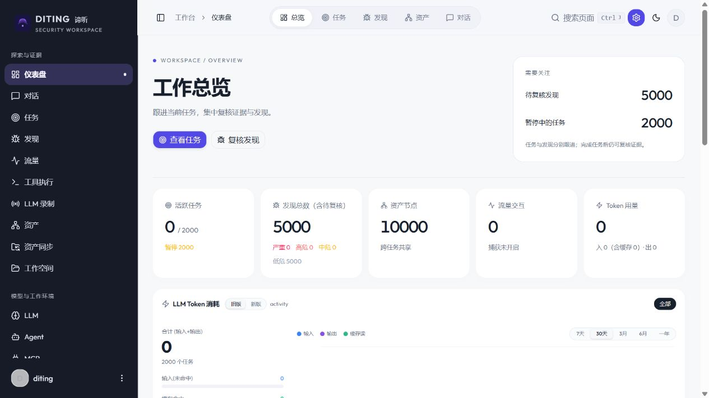
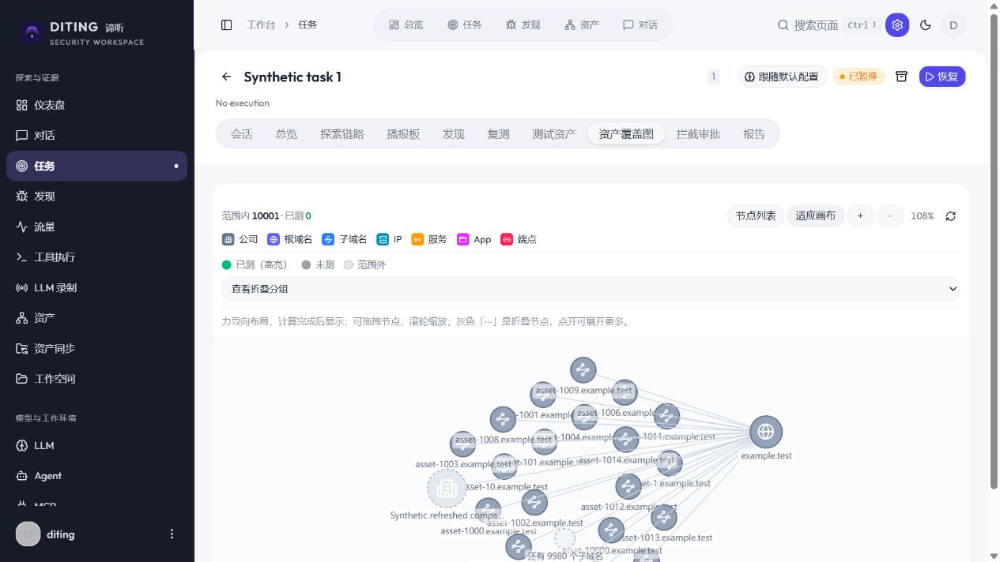
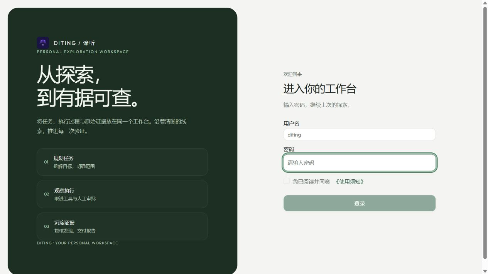
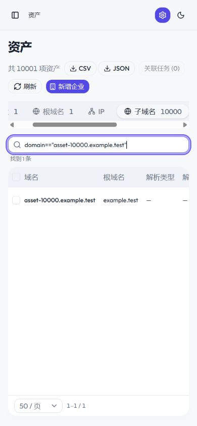

# 谛听 DITING

LLM 驱动的自主渗透测试工作台 · Go + Next.js + PostgreSQL

[下载 2.8.0](https://github.com/bluechips-zhao/DITING/releases/tag/v2.8.0) · [安装与部署](docs/INSTALLATION.md) · [文档导航](docs/README.md) · [版本说明](docs/RELEASE_NOTES.md)

面向获得授权的安全评估，提供任务规划、多代理执行、资产管理、流量证据、人工审批和报告追溯。基于 [ARTEX](https://github.com/Autumn-27/ARTEX) 改造，界面参考 Amicro，支持深浅主题与移动端。

**首次安装业务为空白。** 不预置模型、API Key、管理员密码或演示数据库。截图中的模拟记录仅展示界面，不会导入应用。

## 选择下载

| 使用方式 | 下载与说明 |
| --- | --- |
| Windows amd64 | [Windows 安装包](https://github.com/bluechips-zhao/DITING/releases/download/v2.8.0/DITING-2.8.0-windows-amd64.zip)，另需自己的 PostgreSQL |
| Docker 应用与数据库 | [部署包](https://github.com/bluechips-zhao/DITING/releases/download/v2.8.0/DITING-2.8.0-docker-deployment.zip) + [应用镜像](https://github.com/bluechips-zhao/DITING/releases/download/v2.8.0/DITING-2.8.0-linux-amd64-image.tar) + [PostgreSQL 共享镜像](https://github.com/bluechips-zhao/DITING/releases/download/v2.7.0/PostgreSQL-16.15-linux-amd64-image.tar)；[操作步骤](docs/INSTALLATION.md#docker) |
| 源码构建 | 发行页底部的 **Source code** 或 Git 标签；[构建说明](docs/DEVELOPMENT.md) |

下载后按 [SHA256SUMS](https://github.com/bluechips-zhao/DITING/releases/download/v2.8.0/SHA256SUMS) 校验发行附件。历史版本保留；2.5、2.7 与 2.8 使用同一 PostgreSQL 16.15 镜像，下载入口已统一。

## 快速开始

1. 解压 Windows 包，准备自己的 PostgreSQL，运行 `start.bat`。
2. 打开 [本地工作台](http://127.0.0.1:8787)，按向导配置数据库并初始化登录密码。
3. 在页面保存自己的模型配置，再创建获得授权的评估任务。

Docker 部署、端口设置和启动排障见[安装说明](docs/INSTALLATION.md)。升级前制作[完整加密备份](docs/DATA_AND_BACKUP.md)，数据库迁移后回退需要恢复备份，不能只替换旧二进制。不要上传配置、密钥、数据库、日志或抓包。

## 主要功能

- **任务与代理**：目标、模板、范围约束、多代理协作、预算和人工审批。
- **资产与证据**：企业/任务资产、流量录制、请求响应绑定、发现关系及完整导出。
- **报告与追溯**：企业跨任务汇总、技术明细/管理摘要、脱敏历史和来源版本。
- **复测与变化**：复测开始快照对比、资产字段变化；不补造过去历史。
- **工作台与交互**：中性色布局、深浅主题、键盘导航、总览摘要、长会话和大型资产图改进。
- **配置与恢复**：LLM、MCP、技能、通知、凭据加密及备份恢复。

## 界面预览

以下截图仅含展示用模拟记录，安装时不导入。

| 2.8 工作台 | 资产覆盖图 |
| --- | --- |
|  |  |

登录页与手机界面

| 登录页 | 手机工作台 |
| --- | --- |
|  |  |

## 支持范围与来源

当前正式版为 **2.8.0**。Windows 保留已验收的 2.8 程序原字节，本次复测首次空库、鉴权和配置向导。Linux amd64 镜像从固定的 2.8 源码在 GitHub Ubuntu runner 重建，并通过空库、鉴权及内嵌页面检查；前端单元测试、类型检查和生产导出通过。独立 Linux 原生安装包、macOS 和其他架构未实际验收；真实模型与靶场验收已取消，不计为通过。详细范围见[版本说明](docs/RELEASE_NOTES.md)。

遵守 [AGPL-3.0](LICENSE)，保留 ARTEX 来源及版权；字体和模板许可见[第三方说明](THIRD_PARTY_NOTICES.md)。
