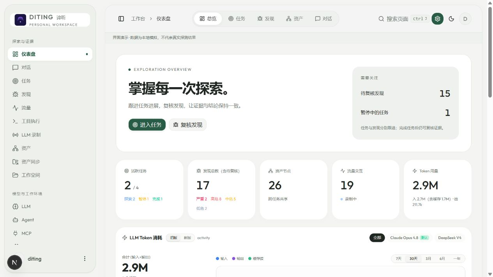
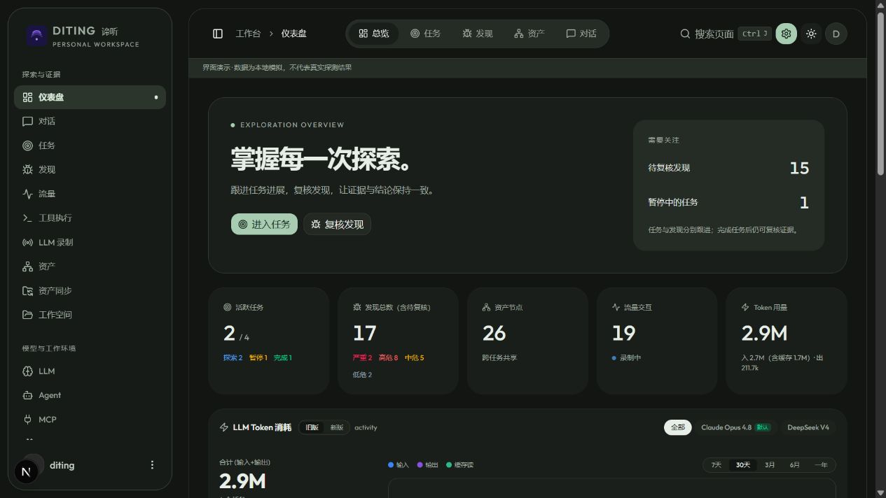
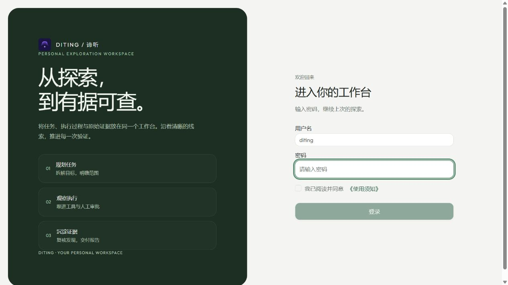
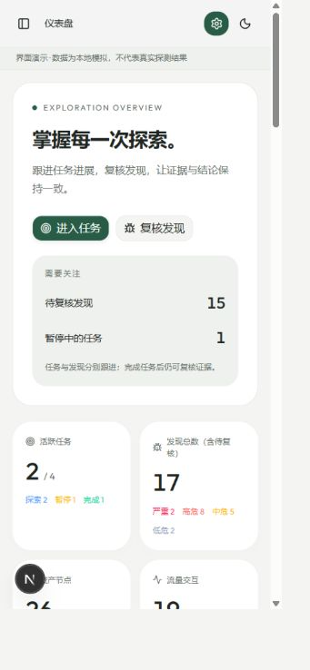

# 谛听 DITING

LLM 驱动的自主渗透测试工作台 · Go + Next.js + PostgreSQL

[下载发行版](https://github.com/bluechips-zhao/DITING/releases) · [界面截图](#界面预览) · [开始使用](#开始使用)

基于 [ARTEX](https://github.com/Autumn-27/ARTEX) 改造，保留资产图、任务探索、多代理协作、流量证据和人工审批，增加预算、证据关系、报告版本、完整导出与加密备份恢复。前端参考 Amicro，支持深浅主题与移动端。仅用于拥有或明确获得授权的目标。

**首次使用为空白业务状态。** 源码和发行包不包含演示数据库、任务、资产、漏洞、对话、模型配置、API Key 或管理员密码。首次启动需要自己的 PostgreSQL、登录密码和模型配置。内置 Agent、工具定义、提示词、拦截规则是功能默认项，会自动初始化。

## 界面预览

以下截图中的模拟记录仅展示界面，**不会随安装导入**。发布源码不提供运行时演示数据或模拟登录。

| 浅色工作台 | 深色工作台 |
| --- | --- |
|  |  |

| 登录页 | 手机工作台 |
| --- | --- |
|  |  |

## 主要功能

- **任务与多代理**：规划、执行、对话、报告代理；模板、目标、约束、运行状态、模型配置链与纠偏入口。
- **预算与收尾**：token/工具预算、保守预留、耗尽后的收尾、有限默认轮次与无进展保护。
- **资产与范围**：企业/任务资产、范围与拦截、筛选、完整 CSV/JSON 导出、批量挂接、ScopeSentry 同步。
- **发现与证据**：请求/响应绑定、重复关系、复测、报告重生成作业、证据版本和历史报告。
- **会话与流量**：搜索与完整历史导出；流量录制、HAR/CSV 和原始报文包导出。
- **系统与恢复**：LLM、MCP、技能、自定义工具、通知、加密备份、恢复预览、隔离恢复和迁移状态。

约束提供代理上下文；工具拦截规则独立执行。token 预算是本地用量账本，不是供应商金额账单。

## 开始使用

### Windows 发行包

1. 从 [Releases](https://github.com/bluechips-zhao/DITING/releases) 下载 Windows amd64 zip，解压到新的目录。
2. 准备 PostgreSQL 16 或更新版本。可连接自己的数据库，或仅用 Docker 创建空库：

   ```powershell
   docker run -d --name diting-postgres -p 127.0.0.1:5433:5432 -e POSTGRES_USER=diting -e POSTGRES_PASSWORD=YOUR_DATABASE_PASSWORD -e POSTGRES_DB=diting -v diting-pgdata:/var/lib/postgresql/data postgres:16
   ```

   将 `YOUR_DATABASE_PASSWORD` 换成自己的强密码。
3. 复制 `config.example.json` 为 `config.json`，填自己的数据库参数。示例是 `127.0.0.1:5433`、用户/数据库 `diting`，密码为空，必须填写。`skill_dir` 留空使用程序旁的 `skills/`。
4. 运行 `start.bat`，或在 PowerShell 中：

   ```powershell
   .\start.bat -addr 127.0.0.1:8787 -proxy 127.0.0.1:8788
   ```

5. 打开 [本地工作台](http://localhost:8787)，首次进入初始化页，设置至少 8 位登录密码。在「系统 → LLM」添加自己的模型，再创建企业、资产、任务或对话。

发行包内部可执行文件名保留 `artex.exe`，产品品牌为 DITING。启动脚本也支持源码构建的 `diting.exe`。原有 `ARTEX_*` 环境变量保留兼容名称，`ARTEX_PG_DSN` 优先于配置文件；如之前设置过，请确认它指向预期数据库。

本次首发提供 Windows amd64 包。其他平台可从源码编译；跨平台 CI 的结果以对应运行记录为准。

### 从源码构建

需要 Go **1.26.3 或更新版本**、Node.js **22**、npm 和 PostgreSQL。

```powershell
git clone https://github.com/bluechips-zhao/DITING.git
cd DITING
.\build.bat
Copy-Item config.example.json config.json
# 编辑 config.json 后启动
.\start.bat -addr 127.0.0.1:8787 -proxy 127.0.0.1:8788
```

Windows 可分发 zip：

```powershell
powershell -ExecutionPolicy Bypass -File scripts/package-release.ps1 -Version 2.3.0
```

打包脚本按固定文件清单组装，不复制配置、JWT 密钥、数据库、日志或工作区文件；输出到 `dist/`，拒绝覆盖已有同版本产物。

Linux/macOS 需要 Bash、rsync；打包还需 zip：

```bash
./build.sh --target linux/amd64
cp config.example.json config.json
# 编辑 config.json 后启动
./dist/artex-linux-amd64/artex -addr 127.0.0.1:8787 -proxy 127.0.0.1:8788
```

### 开发模式

后端 `go run ./cmd/artex`；另一终端进入 `web`，执行 `npm ci`、`npm run dev -- --port 5173`。前端 API 默认反代后端 8787。未配置模型时没有预置模型，也不会自动调用供应商。[开发指南](AGENTS.md) 记录代码入口与配置优先级。

## 数据与备份

- 业务和模型凭据保存在自己的 PostgreSQL；工作区与录制文件在应用数据目录。JWT 签名密钥首次运行随机生成。
- 不提交或转发 `config.json`、`.env`、`jwt.key`、`data/`、日志、抓包和备份；源码忽略规则覆盖这些文件。
- 制作一致备份前停止任务、应用和代理；恢复使用新的空数据库与新的数据目录。
- 连接已有数据库会保留原有记录并执行幂等迁移。“首次为空白”指新建数据库，不会清空旧数据库。
- 下载包可与发行页 `SHA256SUMS` 对比：`Get-FileHash .\artex-2.3.0-windows-amd64.zip -Algorithm SHA256`。

## 许可证与来源

遵守 [AGPL-3.0](LICENSE)，保留 ARTEX 源码来源及版权。修改后通过网络向其他用户提供服务时，按许可证提供对应源码。

字体和前端模板许可见 [第三方说明](THIRD_PARTY_NOTICES.md)。UI 参考 [Amicro](https://github.com/Subhan-code/Amicro--Micro-transitions-)，产品布局与流程按 DITING 调整。
