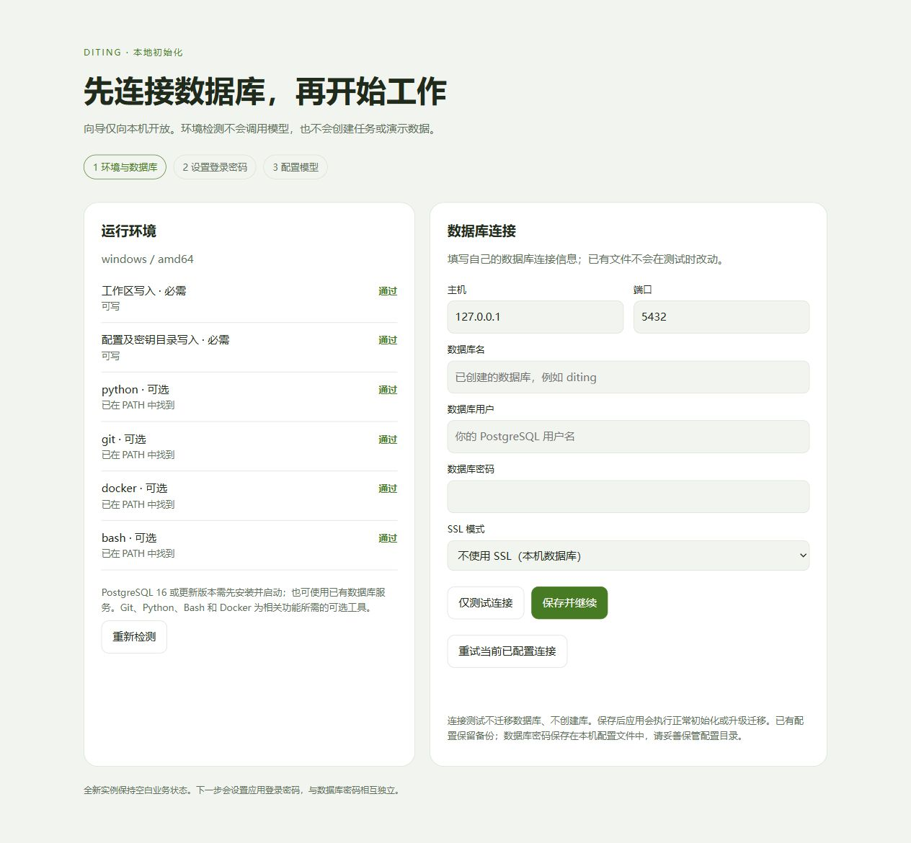

# 安装与部署

[返回首页](../README.md) · [文档索引](README.md)

## 开始使用

### Windows 发行包

1. 从 [Releases](https://github.com/bluechips-zhao/DITING/releases) 下载 Windows amd64 zip，解压到新的目录。
2. 准备 PostgreSQL 16 或更新版本。可连接自己的数据库，或仅用 Docker 创建空库：

   ```powershell
   docker run -d --name diting-postgres -p 127.0.0.1:5433:5432 -e POSTGRES_USER=diting -e POSTGRES_PASSWORD=YOUR_DATABASE_PASSWORD -e POSTGRES_DB=diting -v diting-pgdata:/var/lib/postgresql/data postgres:16
   ```

   将 `YOUR_DATABASE_PASSWORD` 换成自己的强密码。
3. 2.4.0 起可直接运行 `start.bat`，在本机数据库向导填写连接信息。也可复制 `config.example.json` 为 `config.json` 手动配置；示例为 `127.0.0.1:5433`、用户/数据库 `diting`，密码必须自行填写。`skill_dir` 留空使用程序旁的 `skills/`。
4. 运行 `start.bat`，或在 PowerShell 中：

   ```powershell
   .\start.bat -addr 127.0.0.1:8787 -proxy 127.0.0.1:8788
   ```

5. 打开 [本地工作台](http://localhost:8787)。2.4.0 起数据库未配置或连接失败时显示本机向导；连接测试不创建数据库、不改动配置，保存成功后同一进程进入密码初始化。设置至少 8 位登录密码，随后完成环境检查和模型配置；模型保存不发起供应商请求。可稍后从「系统配置 → 初始化与环境检查」返回向导，再创建企业、资产、任务或对话。

数据库初始化向导（隔离验收实例，无业务数据或凭据）：



向导仅绑定回环地址，并检查本机来源、Host、Origin 和一次性启动令牌。文件配置修改保留原文件备份；已有配置 JSON 无效时拒绝覆盖。`ARTEX_PG_DSN` 已设置时，只允许重试该连接，不保存会被环境变量覆盖的文件配置。默认应用监听为 `127.0.0.1:8787`；需要其他监听地址时显式指定 `-addr`。

发行包内部可执行文件名保留 `artex.exe`，产品品牌为 DITING。启动脚本也支持源码构建的 `diting.exe`。原有 `ARTEX_*` 环境变量保留兼容名称，`ARTEX_PG_DSN` 优先于配置文件；如之前设置过，请确认它指向预期数据库。

本版提供 Windows amd64 包。其他平台可从源码编译；跨平台 CI 的结果以对应运行记录为准。

<a id="docker"></a>

### 应用与数据库 Docker 部署（2.7.0）

随版提供经本次离线逐层审查的既有 Linux amd64 镜像归档。其历史隔离验收在 Windows Docker Desktop 完成，包含空卷安装、登录、持久化重建、升级、加密备份与隔离恢复。本次发布时本机 Docker 引擎不可用，未重新运行容器；独立 Linux/macOS 宿主仍未验收。镜像保留原构建内容及标签，不把历史运行记录冒充本次重新构建。使用 Docker Desktop 的 Linux 引擎或 Linux Docker Engine，可从源码构建：

```powershell
Copy-Item .env.example .env
# 编辑 .env，填写自己的 POSTGRES_PASSWORD；空密码会被拒绝。
docker compose -p diting build artex
docker compose -p diting up -d
docker compose -p diting ps
```

GitHub 发行附件提供应用与 PostgreSQL 镜像归档。将部署包解压，在含 `docker-compose.yml` 的目录运行；镜像路径按实际保存位置填写：

```powershell
docker load -i DITING-2.7.0-linux-amd64-image.tar
docker load -i PostgreSQL-16.15-linux-amd64-image.tar
Copy-Item .env.example .env
# 编辑 .env，填写自己的 POSTGRES_PASSWORD。
docker compose -p diting --env-file .env up -d --no-build --wait
docker compose -p diting --env-file .env ps
```

此方式不需要构建或下载已提供的镜像；首次安装仍需用户自行设置密码。镜像不包含数据库、业务数据或模型凭据。Docker 部署包与两个镜像归档均需保留；备份工具的宿主机 Python 依赖需另行安装，不承诺该依赖安装过程离线可用。

打开 `http://127.0.0.1:8787` 初始化登录密码和模型。数据库自动创建空库；模型、任务、企业、资产、发现和对话均不预置。Compose 将 PostgreSQL 固定为 16.15，等待数据库健康后启动应用，应用健康检查也验证数据库连接。数据库不发布宿主端口；应用与录制代理仅映射本机 `8787/8788`，可通过 `.env` 更改端口。

应用使用 UID/GID 10001 运行。`ARTEX_HOME=/var/lib/diting/runtime` 保存配置、`jwt.key` 与 `secrets.key`；工作区在独立 `/var/lib/diting/data` 卷，避免密钥出现在可浏览工作区。技能及工具用户目录分别持久化，首次空技能卷从镜像初始化，重建后保留用户修改。`ARTEX_HOME` 必须使用绝对路径；Windows 未设置时保留原程序目录行为，`ARTEX_CONFIG` 仍可单独指定配置文件。

固定项目名 `-p diting` 保证重建继续使用同一批卷。`docker compose -p diting down` 保留卷；不要在升级时加 `-v`。容器中的更新入口只用于检查版本；应用升级应先停机完整备份，再构建或载入目标镜像并重建应用。回退旧版需要恢复升级前完整备份到新库和新卷。[Docker 备份恢复操作说明](DOCKER_BACKUP.md)介绍完整操作及限制。验收使用隔离测试数据，没有真实模型或目标调用。

遇到部署故障时，先查看服务状态和近期日志：

```sh
docker compose -p diting ps -a
docker compose -p diting logs --tail 100 postgres artex
```

- 构建依赖下载超时：检查宿主机及容器访问下载源的连接。需要宿主机代理时，在本次 `docker build` 中显式传入 `HTTP_PROXY`、`HTTPS_PROXY`，并添加 `--add-host host.docker.internal=host-gateway`；代理地址及凭据不要提交到源码。BuildKit 会缓存 npm 依赖，重新构建可以复用缓存。
- PostgreSQL 不健康：检查数据库服务日志、卷的可用空间和 `.env` 密码。已有数据库卷不会因为修改 `POSTGRES_PASSWORD` 自动修改数据库内的密码；需按 PostgreSQL 的密码变更流程同步修改，不能靠删除卷解决。
- 应用返回健康检查 503：数据库连接暂时不可用。先恢复数据库服务及连接，再检查应用健康状态；数据库健康后应用才会正常响应。
- 应用报告凭据密钥不匹配：恢复该数据库对应的 `secrets.key`。不要生成新密钥覆盖原文件，也不要把密钥放入工作区。
- Docker Desktop 在应用容器创建前提示 `dockerInference` 或 `engine.sock` 无法访问：这是 Docker Desktop 启动阶段的问题，[Docker 问题库有同类报告](https://github.com/docker/desktop-feedback/issues/554)。先退出 Desktop，按厂商说明恢复其运行目录；不要为此重置数据、注销 WSL 或删除业务卷。日志可能含敏感信息，分享前自行脱敏。
- Windows 报 `bind: ... forbidden by its access permissions`，且端口没有监听者时，执行 `netsh interface ipv4 show excludedportrange protocol=tcp` 检查系统保留范围。为本机程序的 `-addr`，或 Compose `.env` 中的 `DITING_PORT` / `DITING_PROXY_PORT` 另选未保留的空闲端口；保持绑定 `127.0.0.1`。不要通过关闭防火墙或删除系统端口保留来绕过。


## 发行附件与共享镜像

Windows 用户下载对应版本的 Windows ZIP；Docker 用户下载部署 ZIP、对应版本的应用镜像，以及 PostgreSQL 16.15 共享镜像。PostgreSQL 镜像统一保存在 [2.7 发行附件](https://github.com/bluechips-zhao/DITING/releases/download/v2.7.0/PostgreSQL-16.15-linux-amd64-image.tar)，2.5 使用相同文件，SHA256 为 `f5a93d10a4eff72fb1c62427c5a23cdd39aac64d81dec2200e8b67fabff66ea7`，也保留在 2.5 的校验清单中。应用镜像不能跨版本混用。

源码使用各发行页底部的 **Source code (zip / tar.gz)** 或 Git 标签下载；不再重复上传手工源码 ZIP。源码压缩包没有承诺固定摘要，`SHA256SUMS` 校验的是发行附件及注明的共享镜像。
